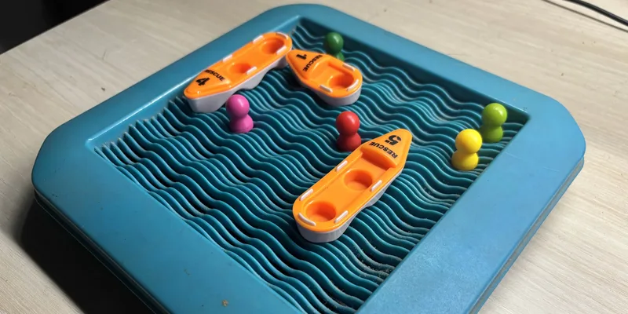

> **Template note:** everything marked _[Placeholder]_ needs your own words.
> Delete this note when you publish. The headings below are a suggested shape:
> problem → model → approach → results → takeaways.

Rescue Plan is a puzzle toy where _[Placeholder: the rules in one or two
sentences: what the board looks like, what moves are allowed, and what counts
as solved]_. Solving it by hand is fun. Solving it with a computer means first
deciding what a "position" and a "move" actually are.



## Turning the puzzle into a graph

The trick is to stop thinking about the physical pieces and start thinking
about **states**:

- Each **vertex** is one configuration of the board.
- Each **edge** is one valid lifeboat move from one configuration to another.
- The **start** is the puzzle's initial layout, and the **goal** is any
  configuration where _[Placeholder: the win condition]_.

Once the puzzle is a graph, solving it is a path-finding problem: find a path
from the start vertex to a goal vertex.

_[Placeholder: how you encoded a state in code, e.g. a 2D array or a string
key, and how you avoided visiting the same state twice.]_

## Searching it: BFS vs DFS

Both algorithms walk the same graph. They differ in the order they explore it.

**Breadth-first search** explores every state one move away, then every state
two moves away, and so on. The first time it reaches a goal, that path is
guaranteed to be the shortest.

**Depth-first search** follows one line of moves as far as it can before
backing up. It doesn't guarantee the shortest path, but when the graph branches
heavily it can stumble on _a_ solution sooner.

A simplified version of the BFS loop:

```java
// [Placeholder] Replace with the real code from RescuePlanSearcher.
Queue<State> queue = new ArrayDeque<>();
Map<State, State> cameFrom = new HashMap<>();
queue.add(start);
cameFrom.put(start, null);

while (!queue.isEmpty()) {
    State current = queue.poll();
    if (current.isGoal()) return rebuildPath(cameFrom, current);

    for (State next : current.validMoves()) {
        if (!cameFrom.containsKey(next)) {
            cameFrom.put(next, current);
            queue.add(next);
        }
    }
}
```

Swapping the queue for a stack (or recursion) turns this into DFS. That
one-line difference is the whole comparison.

## Results

| Puzzle | BFS moves | BFS time | DFS moves | DFS time |
| ------ | --------: | -------: | --------: | -------: |
| _[Placeholder] Level 1_ | – | – | – | – |
| _[Placeholder] Level 2_ | – | – | – | – |

BFS always found the shortest solution. DFS was sometimes faster on
configurations with lots of branching, at the cost of longer, roundabout
paths.

_[Placeholder: one surprising case worth describing in detail.]_

## Takeaways

_[Placeholder: two or three short points: when you'd pick BFS, when DFS, and
what you'd try next (e.g. A\* with a heuristic, or bidirectional search).]_

The full analysis is in the [paper](https://informatika.stei.itb.ac.id/~rinaldi.munir/Stmik/2024-2025/Makalah2025/Makalah-IF2211-Strategi-Algoritma-2025%20(178).pdf),
and the code is on [GitHub](https://github.com/SebastianHYH/RescuePlanSearcher).
